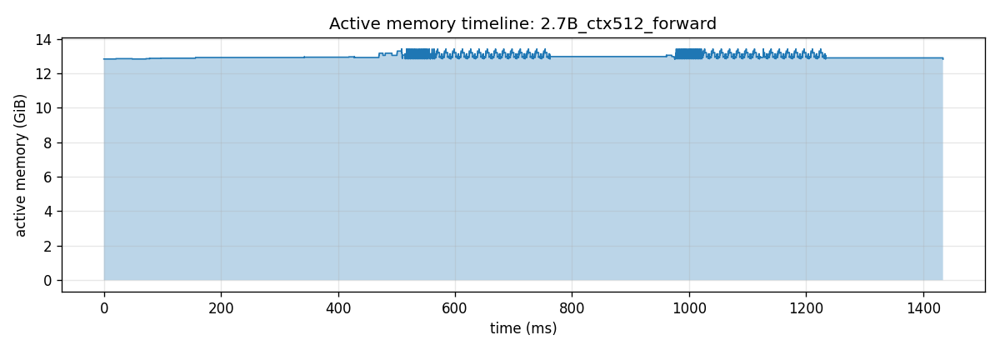
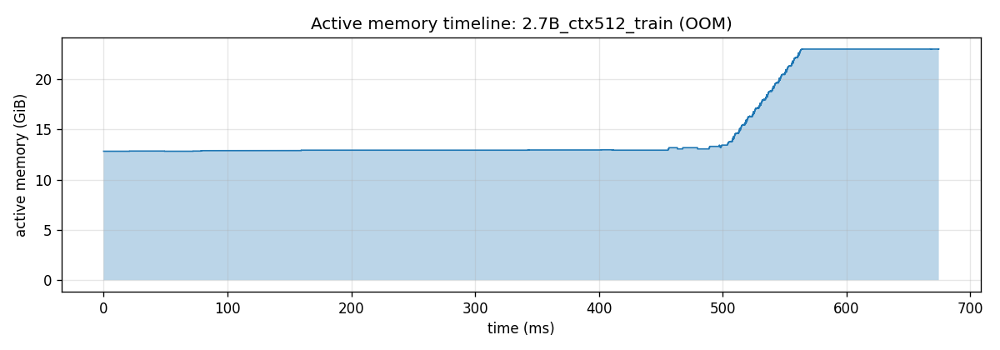
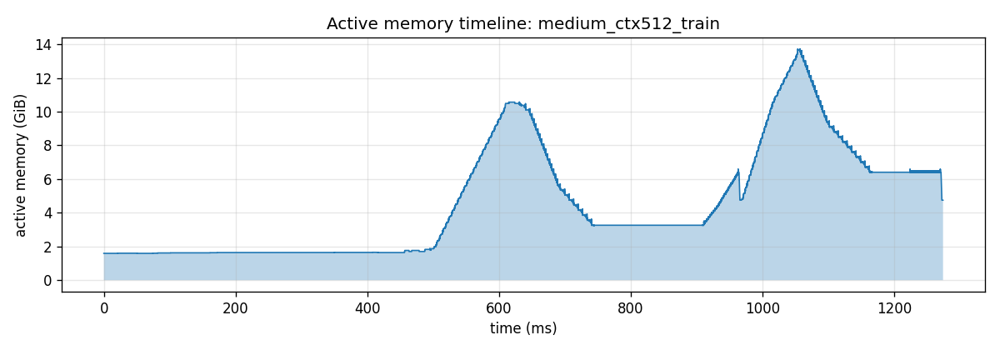

# CS336 Spring 2025 — Assignment 2 (Systems) Writeup

Handout: [cs336_spring2025_assignment2_systems.pdf](./cs336_spring2025_assignment2_systems.pdf)

## Progress

| §  | Problem | Pts | Page | Status |
|----|---------|----:|-----:|--------|
| 1.1.3 | [benchmarking_script](#problem-benchmarking_script-4-points) | 4 | 3 | ✅ done |
| 1.1.4 | [nsys_profile](#problem-nsys_profile-5-points) | 5 | 5 | ✅ done |
| 1.1.5 | [mixed_precision_accumulation](#problem-mixed_precision_accumulation-1-point) | 1 | 6 | ✅ done |
| 1.1.5 | [benchmarking_mixed_precision](#problem-benchmarking_mixed_precision-2-points) | 2 | 7 | ✅ done |
| 1.1.6 | [memory_profiling](#problem-memory_profiling-4-points) | 4 | 8 | ✅ done |
| 1.2.1 | [pytorch_attention](#problem-pytorch_attention-2-points) | 2 | 9 | ✅ done |
| 1.3   | [torch_compile](#problem-torch_compile-2-points) | 2 | 10 | ✅ done |
| 1.3.2 | [flash_forward](#problem-flash_forward-15-points) | 15 | 19 | TODO |
| 1.3.2 | [flash_backward](#problem-flash_backward-5-points) | 5 | 21 | TODO |
| 1.3.2 | [flash_benchmarking](#problem-flash_benchmarking-5-points) | 5 | 21 | TODO |
| 2.1   | [distributed_communication_single_node](#problem-distributed_communication_single_node-5-points) | 5 | 26 | TODO |
| 2.2   | [naive_ddp](#problem-naive_ddp-5-points) | 5 | 27 | TODO |
| 2.2   | [naive_ddp_benchmarking](#problem-naive_ddp_benchmarking-3-points) | 3 | 27 | TODO |
| 2.3.1 | [minimal_ddp_flat_benchmarking](#problem-minimal_ddp_flat_benchmarking-2-points) | 2 | 28 | TODO |
| 2.3.2 | [ddp_overlap_individual_parameters](#problem-ddp_overlap_individual_parameters-5-points) | 5 | 29 | TODO |
| 2.3.2 | [ddp_overlap_individual_parameters_benchmarking](#problem-ddp_overlap_individual_parameters_benchmarking-1-point) | 1 | 30 | TODO |
| 2.3.3 | [ddp_overlap_bucketed](#problem-ddp_overlap_bucketed-8-points) | 8 | 31 | TODO |
| 2.3.3 | [ddp_bucketed_benchmarking](#problem-ddp_bucketed_benchmarking-3-points) | 3 | 31 | TODO |
| 2.4   | [communication_accounting](#problem-communication_accounting-10-points) | 10 | 32 | TODO |
| 3     | [optimizer_state_sharding](#problem-optimizer_state_sharding-15-points) | 15 | 34 | TODO |
| 3     | [optimizer_state_sharding_accounting](#problem-optimizer_state_sharding_accounting-5-points) | 5 | 34 | TODO |

Hardware used: NVIDIA GeForce RTX 4090 D (24 GB; up to 4 GPUs on one PCIe switch, no NVLink) unless noted; some local runs on an RTX 4080 (16 GB). Model sizes (Table 1), vocab 10,000, batch size 4:

| Size | d_model | d_ff | num_layers | num_heads |
|------|--------:|-----:|-----------:|----------:|
| small | 768 | 3072 | 12 | 12 |
| medium | 1024 | 4096 | 24 | 16 |
| large | 1280 | 5120 | 36 | 20 |
| xl | 1600 | 6400 | 48 | 25 |
| 2.7B | 2560 | 10240 | 32 | 32 |

---

# 1. Assignment Overview: Optimizing Single-GPU Performance

## Problem (benchmarking_script): 4 points

### (a)
> Deliverable: A script that will initialize a basics Transformer model with the given hyperparameters, create a random batch of data, and time forward and backward passes.

**Answer:** [benchmark.py](./benchmark.py)

### (b)
> Time the forward and backward passes for the model sizes described in §1.1.2. Use 5 warmup steps and compute the average and standard deviation of timings over 10 measurement steps. How long does a forward pass take? How about a backward pass? Do you see high variability across measurements, or is the standard deviation small?
>
> Deliverable: A 1-2 sentence response with your timings.

Setup: 1× RTX 4090 D (24 GB), FP32, batch size 4, context length 512, vocab 10,000, 5 warm-up + 10 measured steps, `torch.cuda.synchronize()` after each phase. Backward excludes the optimizer step (`--mode forward_backward`).

| Size | Forward mean (ms) | Forward std (ms) | Backward mean (ms) | Backward std (ms) | Bwd / Fwd | Peak memory (GiB) |
|------|------------------:|-----------------:|-------------------:|------------------:|----------:|------------------:|
| small | 32.47 | 0.83 | 55.48 | 0.06 | 1.71 | 4.06 |
| medium | 84.65 | 0.18 | 164.25 | 0.18 | 1.94 | 10.57 |
| large | 169.09 | 0.23 | 337.05 | 0.46 | 1.99 | 20.27 |
| xl | OOM | | OOM | | | > 23.6 |
| 2.7B | OOM | | OOM | | | > 23.6 |

**Answer:** A forward pass takes 32 / 85 / 169 ms for small / medium / large, and a backward pass takes 55 / 164 / 337 ms. Backward converges to about 2× the forward time as the model grows, which matches backward doing twice the matmul FLOPs. xl and 2.7B run out of memory on a 24 GB GPU in FP32, because their parameters plus gradients alone are 14.9 / 25.4 GiB before any activations. Variability is very small: the standard deviation is below 1 ms (< 3% of the mean) in every configuration, and the largest value (small forward, 0.83 ms) comes from a single 34.8 ms outlier step.

### (c)
> Repeat your analysis without the warm-up steps. How does this affect your results? Why do you think this happens? Also try to run the script with 1 or 2 warm-up steps. Why might the result still be different?
>
> Deliverable: A 2-3 sentence response.

| Warm-up steps (small) | Forward mean ± std (ms) | Backward mean ± std (ms) | First measured step fwd / bwd (ms) |
|----------------------:|------------------------:|-------------------------:|-----------------------------------:|
| 0 | 85.11 ± 166.67 | 65.81 ± 31.87 | 559.45 / 156.50 |
| 1 | 32.81 ± 0.30 | 55.59 ± 0.19 | 33.38 / 56.10 |
| 2 | 32.13 ± 0.83 | 55.63 ± 0.36 | 31.96 / 56.56 |
| 5 | 32.47 ± 0.83 | 55.48 ± 0.06 | 32.26 / 55.39 |

**Answer:** Without warm-up, the first step is much slower: the forward takes 559 ms (about 17× steady state) and the backward 157 ms (about 2.8×). This inflates the mean forward time to 85 ms and its std to 167 ms, so the result is dominated by a single outlier. The first iteration pays one-time costs: lazy CUDA context and module/kernel loading, cuBLAS handle creation and algorithm selection, the caching allocator's first `cudaMalloc` calls, and building the autograd machinery for the first backward. With 1 or 2 warm-up steps the numbers already match the 5-step results within noise on this setup. In general they can still differ, because some costs settle over several iterations (the allocator pool still growing, the GPU ramping clocks up from its idle power state, autotuning or `torch.compile` recompilation), so a few extra warm-up steps are the safer default.

---

## Problem (nsys_profile): 5 points

> Profile your forward pass, backward pass, and optimizer step using nsys with each of the model sizes described in Table 1 and context lengths of 128, 256, 512 and 1024 (note OOMs in your report).

Setup: 1× RTX 4090 D, FP32, batch size 4, Nsight Systems 2024.6.2 (`-t cuda,nvtx`). The system nsys 2023.4 failed to import about a third of the traces ("Wrong event order"). Only the 10 measured steps are captured: [benchmark.py](./benchmark.py) calls `cudaProfilerStart/Stop` around them and nsys runs with `--capture-range=cudaProfilerApi`, so warm-up is excluded. For each config I tried a full training step first, then fell back to forward+backward, then forward-only (`no_grad`) on OOM. Sweep: [scripts/nsys_sweep.sh](./scripts/nsys_sweep.sh). Kernel attribution to NVTX ranges (via each kernel's launch on the CPU): [scripts/nsys_analyze.py](./scripts/nsys_analyze.py).

Mean per-phase time over 10 steps (GPU span of the NVTX range, ms), shown as forward / backward / optimizer:

| Size \ context_length | 128 | 256 | 512 | 1024 |
|------|----:|----:|----:|-----:|
| small | 39.8 / 43.3 / 27.8 | 40.4 / 44.8 / 27.8 | 41.5 / 56.3 / 28.3 | 75.8 / 157.5 / 28.1 |
| medium | 80.2 / 97.0 / 55.8 | 82.3 / 88.9 / 56.8 | 86.2 / 165.6 / 55.1 | 208.7 / OOM / OOM |
| large | 122.0 / 136.1 / 87.6 | 119.4 / 146.8 / 87.8 | 170.6 / 339.1 / OOM | 424.7 / OOM / OOM |
| xl | 159.4 / 180.0 / OOM | 161.8 / 293.2 / OOM | 325.9 / OOM / OOM | 796.1 / OOM / OOM |
| 2.7B | 112.9 / OOM / OOM | 209.4 / OOM / OOM | 444.4 / OOM / OOM | 1030.3 / OOM / OOM |

"OOM" means that phase doesn't fit in 24 GB. When only the optimizer OOMs, forward/backward come from the `forward_backward` run. When backward also OOMs, the forward comes from a `no_grad` inference run.

### (a)
> What is the total time spent on your forward pass? Does it match what we had measured before with the Python standard library?
>
> Deliverable: A 1-2 sentence response.

**Answer:** At context 512 the forward pass takes 41.5 / 86.2 / 170.6 ms for small / medium / large (table above). This matches the Python `timeit` numbers from the same runs within 0.2 ms, since we synchronize at the end of every phase. It also matches the un-profiled benchmark (84.7 / 169.1 ms for medium / large) within about 2%. The exception is small: 41.5 ms under nsys vs. 32.5 ms without. Small is launch-bound, with only 24 ms of kernel time inside a 41 ms forward, so the per-launch overhead of CUDA API tracing shows up directly.

### (b)
> What CUDA kernel takes the most cumulative GPU time during the forward pass? How many times is this kernel invoked during a single forward pass of your model? Is it the same kernel that takes the most runtime when you do both forward and backward passes?
>
> Deliverable: A 1-2 sentence response.

**Answer:** In the forward pass the top kernel is cuBLAS's FP32 SIMT GEMM `ampere_sgemm_128x64_tn`: 57.6% of forward GPU time for medium at context 512. It is invoked 168 times per forward, which is 7 per layer × 24 layers: the Q, K, V and output projections plus the three SwiGLU matrices. Small calls it 84 = 7 × 12 times. For a full training step it is no longer the top kernel. Instead the top kernels are `vectorized_elementwise_kernel` (32% for medium, about 5,000 launches per step, mostly the backward mul/add and the AdamW update) and CUTLASS's `cutlass::Kernel2<cutlass_80_simt_sgemm_...>` (the backward-pass GEMMs; 23% for medium, and the top kernel for xl at 27%).

| medium, ctx 512 | Top kernel | ms / step | calls / step | % of GPU time |
|---|---|---:|---:|---:|
| forward | `ampere_sgemm_128x64_tn` | 46.9 | 168 | 57.6% |
| full training step | `vectorized_elementwise_kernel` | 87.8 | 4996 | 32.4% |
| | `cutlass::Kernel2` (SIMT sgemm) | 62.5 | 242 | 23.1% |
| | `ampere_sgemm_128x64_tn` | 46.9 | 168 | 17.3% |

### (c)
> What other kernels besides matrix multiplies do you see accounting for non-trivial CUDA runtime in the forward pass?
>
> Deliverable: A 1-2 sentence response.

**Answer:** Elementwise kernels make up about 30% of forward GPU time for medium at context 512: `vectorized_elementwise_kernel` 16.6% and `elementwise_kernel` 14.7%. These are the multiplies (SwiGLU gating, RMSNorm scale, attention scale), the residual adds, `exp`/`neg`/`where` for softmax, SiLU and masking, and copies to make tensors contiguous when splitting and merging heads. `reduce_kernel` (the softmax max/sum and the RMSNorm mean) adds about 3.6%. Their share grows with context length, because the attention-score elementwise ops scale as O(seq²): matmuls drop to 45–60% of forward time at context 1024 for small through xl (44.7% for small, 58.8% for xl).

### (d)
> Profile running one complete training step with your implementation of AdamW. How does the fraction of time spent on matrix multiplication change, compared to doing inference (forward pass only)? How about other kernels?
>
> Deliverable: A 1-2 sentence response.

**Answer:** The matmul share of GPU time drops from the forward pass to a full training step:

| Config | Matmul share, forward | Matmul share, full train step |
|---|---:|---:|
| small, ctx 512 | 61.0% | 48.5% |
| medium, ctx 512 | 64.7% | 50.7% |
| large, ctx 256 | 82.3% | 51.8% |

The backward pass roughly doubles the matmul work, but it also adds even more elementwise work: the gradients of every pointwise op and the gradient accumulation. The AdamW step is purely elementwise: about 28 ms of small kernels per step for medium, several per parameter tensor. So elementwise kernels become the single largest category (`vectorized_elementwise_kernel` is about 32% of the step). The optimizer is also launch-bound, taking about 55 ms of wall time for 28 ms of kernels.

### (e)
> Compare the runtime of the softmax operation versus the matrix multiplication operations within the self-attention layer of your model during a forward pass. How does the difference in runtimes compare to the difference in FLOPs?
>
> Deliverable: A 1-2 sentence response.

**Answer:** The two attention matmuls (QKᵀ and PV) cost about 4·B·H·S²·d_head FLOPs per layer. Softmax costs about 5·B·H·S² (max, subtract, exp, sum, divide), so it has about 4·64/5 ≈ 50× fewer FLOPs (d_head = 64). Yet its runtime is comparable to or larger than both matmuls together, and the gap grows with context length:

| Config (forward, ms/step) | QKᵀ | softmax | PV | softmax / (QKᵀ+PV) |
|---|---:|---:|---:|---:|
| medium, ctx 256 | 1.08 | 1.20 | 1.25 | 0.52 |
| medium, ctx 512 | 4.96 | 11.51 | 3.54 | 1.35 |
| medium, ctx 1024 | 21.58 | 56.02 | 11.13 | 1.71 |
| xl, ctx 1024 | 68.44 | 174.50 | 34.59 | 1.69 |

Softmax is memory-bound: each of its elementwise passes reads and writes the whole B·H·S² score tensor from HBM. The matmuls are compute-bound and reuse data from on-chip memory. So FLOPs are a poor predictor of runtime for softmax. This is exactly the cost FlashAttention removes by fusing softmax into the tiled matmuls. The masking `where` adds roughly another 0.3× of the matmul time at context ≥ 512.

---

## Problem (mixed_precision_accumulation): 1 point

> Run the given accumulation code (fp32 / fp16 / mixed sums of 0.01 × 1000) and comment on the (accuracy of the) results.
>
> Deliverable: A 2-3 sentence response.

| Accumulator | Addend | Result |
|-------------|--------|--------|
| float32 | float32 | 10.000134 |
| float16 | float16 | 9.953125 |
| float32 | float16 | 10.002136 |
| float32 | float16 → float32 | 10.002136 |

Script: [scripts/mixed_precision_toy.py](./scripts/mixed_precision_toy.py).

**Answer:** Accumulating in FP32 is nearly exact (10.000134). Accumulating in FP16 drifts to 9.953 (−0.47%): once the sum passes 8, the gap between neighboring FP16 values is 2⁻⁷ ≈ 0.0078, so every `+0.01` is rounded to a multiple of that gap and the rounding errors pile up. Both mixed variants give 10.002136, and that error comes entirely from the FP16 *input*: 0.01 is stored in FP16 as 0.0100021, and 1000 × 0.0100021 = 10.0021. The FP32 accumulation itself adds no error, and adding an FP16 tensor to an FP32 one type-promotes it, so the implicit and explicit casts behave the same. The lesson: low-precision inputs cost only their own representation error, but low-precision accumulators compound rounding error, so reductions and accumulations should stay in FP32.

---

## Problem (benchmarking_mixed_precision): 2 points

### (a)
> For `ToyModel` trained with FP16 autocast (parameters originally FP32), what are the data types of the following?
>
> Deliverable: The data types for each of the components listed above.

| Component | dtype |
|-----------|-------|
| model parameters within the autocast context | `float32` (autocast casts copies for each op; the stored parameters stay FP32) |
| output of `fc1` | `float16` |
| output of `ln` | `float32` (layer_norm is on autocast's FP32 list) |
| predicted logits | `float16` |
| loss | `float32` (cross_entropy is on autocast's FP32 list) |
| gradients | `float32` (gradients match the FP32 parameters) |

Verified by running the toy model under autocast in [scripts/mixed_precision_toy.py](./scripts/mixed_precision_toy.py). BF16 gives the same pattern, with `bfloat16` in place of `float16`.

### (b)
> What parts of layer normalization are sensitive to mixed precision? If we use BF16 instead of FP16, do we still need to treat layer normalization differently? Why or why not?
>
> Deliverable: A 2-3 sentence response.

**Answer:** The sensitive parts are the reductions and the normalization: computing the mean and variance (a sum of x and of x² over the feature dimension), then dividing by √(var + ε). In FP16, x² overflows for |x| > 256 (max 65504). Summing many terms loses precision with only 10 mantissa bits. ε = 1e-5 is below FP16's smallest normal number (6.1e-5), and a tiny variance makes 1/√var blow up. BF16 has FP32's exponent range, so overflow and underflow mostly go away, but it has only 7 mantissa bits (2–3 significant digits). The mean and variance would still be computed too coarsely, so LayerNorm should still run in FP32. PyTorch's autocast does this for BF16 as well: the `ln` output above is FP32 under BF16 autocast too.

### (c)
> Modify your benchmarking script to optionally run the model using mixed precision with BF16. Time the forward and backward passes with and without mixed-precision for each model size. Compare and comment on any trends as model size changes.
>
> Deliverable: A 2-3 sentence response with your timings and commentary.

`benchmark.py --mixed_precision` wraps the forward pass and loss in `torch.autocast("cuda", dtype=torch.bfloat16)`. Setup: RTX 4090 D, batch 4, context 512, 5 warm-up + 10 measured steps, forward + backward without the optimizer.

| Size | FP32 fwd (ms) | BF16 fwd (ms) | FP32 bwd (ms) | BF16 bwd (ms) | Fwd speedup | Bwd speedup | Peak mem FP32 → BF16 (GiB) |
|------|--------------:|--------------:|--------------:|--------------:|---:|---:|---:|
| small | 31.68 | 34.03 | 55.46 | 36.54 | 0.93× | 1.52× | 4.06 → 3.24 |
| medium | 84.40 | 65.81 | 164.57 | 90.20 | 1.28× | 1.82× | 10.57 → 8.43 |
| large | 169.29 | 99.64 | 337.36 | 189.94 | 1.70× | 1.78× | 20.27 → 16.61 |
| xl | OOM | OOM | OOM | OOM | | | |
| 2.7B | OOM | OOM | OOM | OOM | | | |

**Answer:** BF16 autocast speeds up large by 1.7× (forward) and 1.8× (backward), and medium by 1.3× and 1.8×. In FP32 every matmul runs on CUDA cores (`ampere_sgemm`; TF32 is off by default), while BF16 matmuls run on Tensor Cores. The gain grows with model size, because the large matmuls take a larger share of the time. Small's forward pass is actually 7% *slower* in BF16. It is launch-bound (see nsys_profile), so faster matmuls don't help, and autocast adds a cast kernel for each weight. Its backward still speeds up 1.5×. BF16 also lowers peak memory by about 20%, since the saved activations are half size, but xl and 2.7B still OOM: their FP32 weights and gradients alone are 14.9 / 25.4 GiB.

---

## Problem (memory_profiling): 4 points

> Profile the forward pass, backward pass, and optimizer step of the 2.7B model with context lengths of 128, 256 and 512.

### (a)
> Add an option to your profiling script to run the memory profiler. How do your memory timelines look? Can you tell which stage is running based on the peaks you see?
>
> Deliverable: Two images of the "Active memory timeline" (forward only, and full training step), and a 2-3 sentence response.

`benchmark.py --memory_profile <path>` records CUDA memory history from the first step (1 warm-up + 1 measured step) and dumps a snapshot, even if a step runs out of memory. [scripts/memory_analyze.py](./scripts/memory_analyze.py) rebuilds the "Active Memory Timeline" from the snapshot (as a PNG) and lists the largest allocations with their source lines. On a 24 GB RTX 4090 D, a full 2.7B training step cannot fit: FP32 weights + gradients + AdamW state alone are 4 × 12.7 = 50.8 GiB. So the training-step timelines show the 2.7B run up to its OOM, plus a complete step for **medium**, which fits.

**Answer:** Forward only (no grad), the timeline is a flat 12.8 GiB plateau of FP32 weights. Each layer adds a small temporary bump (at most +0.6 GiB at context 512) because its activations are freed immediately, so each step shows up as a band of 32 small teeth, one per layer. In a training step the stages are easy to read off the medium timeline:

- **Forward:** a linear ramp (1.7 → 10.6 GiB in step 0) as each layer saves its activations.
- **Peak:** at the forward/backward boundary.
- **Backward:** a descent to 3.3 GiB of weights + gradients, as activations are freed layer by layer while gradients are allocated.
- **First optimizer step:** a staircase up to 6.5 GiB as AdamW lazily allocates m and v (4 × 1.58 GiB = weights + grads + m + v).
- **`zero_grad(set_to_none=True)`:** a sharp drop to 4.8 GiB.
- **Step 1:** the same ramp starts from this higher floor, so it peaks higher (13.7 GiB).

For 2.7B, the forward ramp alone climbs from 13 to 23 GiB and runs out of memory partway through the first forward pass, after about 12 of the 32 layers judging by the allocation counts. It never reaches backward or the optimizer.

### (b)
> What is the peak memory usage of each context length when doing a forward pass? What about a full training step?
>
> Deliverable: A table with two numbers per context length.

| context_length | 2.7B forward peak (GiB) | 2.7B train step peak (GiB) | medium train step peak (GiB), for reference |
|---------------:|------------------:|---------------------:|---:|
| 128 | 12.90 | OOM (> 23.1 reached; ≥ 50.8 needed) | 6.54 |
| 256 | 13.00 | OOM (> 23.1 reached) | 8.49 |
| 512 | 13.42 | OOM (> 23.0 reached) | 13.73 |

Forward peaks barely depend on context length: weights dominate, and only one layer's activations are alive at a time. Training peaks grow quickly with context length, because all layers' activations, including the O(S²) attention scores, are kept for backward.

### (c)
> Find the peak memory usage of the 2.7B model when using mixed-precision, for both a forward pass and a full optimizer step. Does mixed-precision significantly affect memory usage?
>
> Deliverable: A 2-3 sentence response.

**Answer:** With BF16 autocast at context 512, the 2.7B forward peak *rises* from 13.42 to 19.38 GiB, and the training step still runs out of memory (23.0 GiB reached). For a forward pass, autocast caches a BF16 copy of every FP32 weight (+6.3 GiB) for the whole autocast region, while the per-layer activations it saves are small. For training, BF16 halves the saved activations (the 128 MiB attention-score tensors become 64 MiB), but weights, gradients and AdamW state stay in FP32 (50.8 GiB). So mixed precision doesn't significantly reduce memory for this model: it helps activation-heavy settings (long context, big batch), not parameter-dominated ones. In the medium/large benchmarks above it cut peak memory by about 20%.

### (d)
> At our reference hyperparameters, what is the size of a tensor of activations in the Transformer residual stream, in single-precision? Give this size in MB.
>
> Deliverable: A 1-2 sentence response with your derivation.

**Answer:** One residual-stream activation tensor has shape batch × context × d_model. At batch 4, context 512 and d_model 2560 in FP32 that is 4 × 512 × 2560 × 4 B = 20,971,520 B = **20 MB** (5 MB at context 128 and 10 MB at 256). The model stores at least one such tensor per layer for backward, plus several larger ones inside each block (the 4× wider SwiGLU hidden states and the B·H·S² attention scores).

### (e)
> In memory_viz with reduced "Detail", what is the size of the largest allocations shown? Looking through the stack trace, can you tell where those allocations come from?
>
> Deliverable: A 1-2 sentence response.

**Answer:** In the 2.7B forward pass at context 512, the largest allocations are **128 MiB**. That is exactly one attention-score tensor: B × H × S × S × 4 B = 4 × 32 × 512 × 512 × 4. The stack traces point to `scaled_dot_product_attention` (the QKᵀ einsum, `model.py:428`, and the mask `torch.where`, `:432`) and to the three steps of our softmax (`nn_utils.py:5–7`: subtract max, exp, divide). There are 64 to 128 of each, i.e. 2 to 4 per layer over 32 layers × 2 steps. The next-largest are **80 MiB**: the B × S × d_ff SwiGLU hidden states, from the `Linear` einsum (`model.py:42`) and `silu` (`model.py:549`). At context 128 the S² tensors shrink 16× to 8 MiB, so these FFN tensors (20 MiB) become the largest.

---

## Problem (pytorch_attention): 2 points

> Batch size 8, no head dimension; d_model ∈ {16, 32, 64, 128} × seq_len ∈ {256, 1024, 4096, 8192, 16384}. Time 100 forward passes, measure memory in use before the backward pass starts, and time 100 backward passes. At what size do you get OOM? Do the memory accounting for the smallest OOM config. How does the memory saved for backward change with sequence length? What would you do to eliminate this memory cost?
>
> Deliverable: A table with your timings, your working out for the memory usage, and a 1-2 paragraph response.

Script: [cs336_systems/benchmark_pytorch_attention.py](./cs336_systems/benchmark_pytorch_attention.py). Setup: RTX 4090 D (24 GB), FP32, batch 8, single head, causal mask, 10 warm-up iterations. Forward is timed over 100 `no_grad` passes. Memory is `torch.cuda.memory_allocated()` right after one forward with grad, i.e. inputs plus everything saved for backward. Backward is timed over 100 `out.backward(retain_graph=True)` calls through that graph. Times are per pass.

| d_model | seq_len | forward (ms) | backward (ms) | memory before backward (MiB) | peak during forward (MiB) |
|---:|---:|---:|---:|---:|---:|
| 16 | 256 | 0.220 | 0.476 | 21.0 | 24.7 |
| 16 | 1024 | 0.373 | 1.081 | 83.9 | 146.9 |
| 16 | 4096 | 8.375 | 19.450 | 1066.7 | 2086.7 |
| 16 | 8192 | 32.571 | 75.576 | 4197.1 | 8285.1 |
| 16 | 16384 | OOM | OOM | OOM | OOM |
| 32 | 256 | 0.218 | 0.472 | 21.6 | 25.1 |
| 32 | 1024 | 0.381 | 1.019 | 86.4 | 148.4 |
| 32 | 4096 | 8.412 | 19.514 | 1076.7 | 2092.7 |
| 32 | 8192 | 32.746 | 75.808 | 4217.1 | 8297.1 |
| 32 | 16384 | OOM | OOM | OOM | OOM |
| 64 | 256 | 0.222 | 0.480 | 22.8 | 25.8 |
| 64 | 1024 | 0.387 | 1.034 | 91.4 | 151.4 |
| 64 | 4096 | 8.475 | 19.786 | 1096.7 | 2104.7 |
| 64 | 8192 | 32.918 | 76.136 | 4257.1 | 8321.1 |
| 64 | 16384 | OOM | OOM | OOM | OOM |
| 128 | 256 | 0.219 | 0.493 | 25.3 | 27.3 |
| 128 | 1024 | 0.413 | 1.090 | 101.4 | 157.4 |
| 128 | 4096 | 8.802 | 20.047 | 1136.7 | 2128.7 |
| 128 | 8192 | 34.312 | 77.734 | 4337.1 | 8369.1 |
| 128 | 16384 | OOM | OOM | OOM | OOM |

**Memory accounting.** Every d_model runs out of memory at seq_len = 16384; the smallest such config is d_model = 16. One B × S × S FP32 score matrix there is 8 × 16384² × 4 B = 8 GiB. Our attention computes, in order: `QKᵀ`, `/√d`, `where(mask)`, `x − max`, `exp`, `/ sum`, then `@ V`. Autograd keeps two S × S tensors for backward: the `exp` output (needed by the division) and the softmax probabilities (needed by `@ V`). `where` keeps only the S × S boolean mask (1 B/element, 256 MiB, shared across the batch). Q, K, V and the output are only B·S·d·4 B = 8 MiB each. So:

- **saved for backward** ≈ 2 × 8 GiB + 0.25 GiB + 4 × 8 MiB ≈ **16.3 GiB**;
- **peak during forward** ≈ 4 × 8 GiB = **32 GiB**, since two to three temporaries (scores, scaled/masked scores, x − max) are alive alongside the saved tensors.

That exceeds the 23.6 GiB GPU. The measurements at seq_len = 8192 match this model exactly: one S × S tensor is 2 GiB there, the memory before backward is 4197 MiB ≈ 2 × 2048 MiB + mask (64 MiB) + inputs, and the forward peak is 8285 MiB ≈ 4 × 2048 MiB.

**Answer:** Forward and backward time and the memory saved for backward all grow quadratically with sequence length once S ≥ 4096: each doubling of S costs 3.9× in time and 3.9× in memory (1067 → 4197 MiB). d_model hardly matters (16 → 128 changes memory by about 3%), because the B × S × S score, probability and `exp` tensors dominate, not the B × S × d inputs. Backward is about 2.3× slower than forward, since it has to read the saved S × S tensors and write S × S gradients. To eliminate this memory cost, don't materialize the S × S matrices: compute attention in tiles with an online softmax, save only Q, K, V, O and the per-row logsumexp (O(S·d) memory), and recompute each probability tile during backward. That is FlashAttention-2, implemented below. At S = 16384, d = 16, the only extra saved tensor would be the 0.5 MiB logsumexp (B × S floats) instead of about 16 GiB.

---

## Problem (torch_compile): 2 points

### (a)
> Extend your attention benchmarking script to include a compiled version of your PyTorch attention, and compare its performance to the uncompiled version with the same configuration as pytorch_attention.
>
> Deliverable: A table comparing forward and backward timings for compiled vs. uncompiled attention.

`benchmark_pytorch_attention.py --compile` adds `torch.compile(scaled_dot_product_attention)`, with the same configs and protocol as above (per-pass ms; both the grad and no-grad paths are warmed up, and shapes are compiled as static).

| d_model | seq_len | Fwd eager (ms) | Fwd compiled (ms) | Bwd eager (ms) | Bwd compiled (ms) | Fwd / bwd speedup | Peak in forward, eager → compiled (MiB) |
|---:|---:|---:|---:|---:|---:|---:|---:|
| 16 | 256 | 0.220 | 0.097 | 0.476 | 0.253 | 2.3× / 1.9× | 24.7 → 21.0 |
| 16 | 1024 | 0.373 | 0.164 | 1.081 | 0.585 | 2.3× / 1.8× | 146.9 → 83.9 |
| 16 | 4096 | 8.375 | 2.859 | 19.450 | 8.284 | 2.9× / 2.3× | 2086.7 → 1066.8 |
| 16 | 8192 | 32.571 | 10.640 | 75.576 | 30.941 | 3.1× / 2.4× | 8285.1 → 4197.3 |
| 32 | 256 | 0.218 | 0.094 | 0.472 | 0.254 | 2.3× / 1.9× | 25.1 → 21.6 |
| 32 | 1024 | 0.381 | 0.170 | 1.019 | 0.591 | 2.2× / 1.7× | 148.4 → 86.4 |
| 32 | 4096 | 8.412 | 2.889 | 19.514 | 8.348 | 2.9× / 2.3× | 2092.7 → 1076.8 |
| 32 | 8192 | 32.746 | 10.808 | 75.808 | 31.164 | 3.0× / 2.4× | 8297.1 → 4217.3 |
| 64 | 256 | 0.222 | 0.096 | 0.480 | 0.254 | 2.3× / 1.9× | 25.8 → 22.8 |
| 64 | 1024 | 0.387 | 0.182 | 1.034 | 0.616 | 2.1× / 1.7× | 151.4 → 91.4 |
| 64 | 4096 | 8.475 | 2.958 | 19.786 | 8.469 | 2.9× / 2.3× | 2104.7 → 1096.8 |
| 64 | 8192 | 32.918 | 10.960 | 76.136 | 31.505 | 3.0× / 2.4× | 8321.1 → 4257.3 |
| 128 | 256 | 0.219 | 0.095 | 0.493 | 0.254 | 2.3× / 1.9× | 27.3 → 25.3 |
| 128 | 1024 | 0.413 | 0.207 | 1.090 | 0.677 | 2.0× / 1.6× | 157.4 → 101.4 |
| 128 | 4096 | 8.802 | 3.288 | 20.047 | 8.871 | 2.7× / 2.3× | 2128.7 → 1136.8 |
| 128 | 8192 | 34.312 | 12.314 | 77.734 | 33.015 | 2.8× / 2.4× | 8369.1 → 4337.3 |

Both versions OOM at seq_len = 16384.

**Answer:** The compiled version is 2–3× faster in forward and about 2.4× faster in backward at long sequences. Inductor fuses scale, mask, max, subtract, exp, sum and divide into one or two Triton kernels, so each S × S tensor makes far fewer round trips through HBM. It also halves the forward peak memory, because the temporaries are never materialized. Compilation does *not* reduce the memory saved for backward (identical, about 2 × B·S² floats), and it still runs out of memory at 16384. torch.compile fuses the elementwise work but doesn't restructure the algorithm the way FlashAttention's tiling does.

### (b)
> Compile your entire Transformer model in your end-to-end benchmarking script. How does the performance of the forward pass change? What about the combined forward and backward passes and optimizer steps?
>
> Deliverable: A table comparing your vanilla and compiled Transformer model.

`benchmark.py --compile` applies `torch.compile(model)`. The model's NVTX ranges are stubbed out first, because they caused graph breaks. I also replaced the deprecated `einx.rearrange` with `einx.id` in `model.py`, since its `warnings.warn` broke the graph in every layer. Setup: RTX 4090 D, FP32, batch 4, context 512, 5 warm-up (including compilation) + 10 measured steps.

| Size | Fwd only, vanilla (ms) | Fwd only, compiled (ms) | Fwd+bwd+opt vanilla (ms) | Fwd+bwd+opt compiled (ms) | Speedup (fwd / full step) |
|------|-----------------:|------------------:|-------------------------:|--------------------------:|---:|
| small | 27.81 | 18.91 | 104.91 (31.4 + 55.9 + 17.7) | 78.82 (20.0 + 40.2 + 18.7) | 1.47× / 1.33× |
| medium | 83.78 | 63.37 | 284.12 (84.0 + 164.7 + 35.4) | 217.48 (64.2 + 118.5 + 34.8) | 1.32× / 1.31× |
| large | 167.55 | 127.92 | OOM; fwd+bwd 506.70 | OOM; fwd+bwd 379.10 | 1.31× / 1.34× (fwd+bwd) |
| xl | OOM (fwd+bwd) | | | | |
| 2.7B | OOM (fwd+bwd) | | | | |

**Answer:** Compiling the whole model makes the forward pass 1.3–1.5× faster and forward+backward about 1.35× faster. Inductor fuses the chains of elementwise ops (RMSNorm, SwiGLU, RoPE, residual adds, softmax) into a few Triton kernels, which removes most of the memory traffic and kernel launches. Small benefits most, since it is the most launch-bound. The matmuls themselves don't change. The AdamW step is not compiled, so its time stays the same (about 18 and 35 ms). Fusion also cuts peak memory in forward+backward (medium 10.57 → 8.93 GiB, large 20.27 → 17.04 GiB), because fewer intermediates are saved for backward.

---

## Problem (flash_forward): 15 points

### (a)
> Pure PyTorch (no Triton) `autograd.Function` implementing the FlashAttention-2 forward pass (tiles ≥ 16×16), returning O and saving L, Q, K, V, O.
>
> Deliverable: Implement `adapters.get_flashattention_autograd_function_pytorch`; pass `uv run pytest -k test_flash_forward_pass_pytorch`.

**Answer:** <!-- link to implementation; test result -->

### (b)
> Triton kernel for the FlashAttention-2 forward pass (Algorithm 1), launch grid `(T_q, batch_size)`, wrapped in an `autograd.Function`.
>
> Deliverable: Implement `adapters.get_flashattention_autograd_function_triton`; pass `uv run pytest -k test_flash_forward_pass_triton`.

**Answer:**

### (c)
> Add an `is_causal` flag (default `False`) with in-kernel causal masking (`-1e6` on masked elements), saved as `ctx.is_causal`.
>
> Deliverable: An additional flag for the Triton `autograd.Function` implementing causal masking.

**Answer:**

---

## Problem (flash_backward): 5 points

> Implement the backward pass (Eq. 13–19) using PyTorch + `torch.compile`, computing and using the D vector, returning dQ, dK, dV.
>
> Deliverable: Pass `uv run pytest -k test_flash_backward`.

**Answer:**

---

## Problem (flash_benchmarking): 5 points

> Using `triton.testing.do_bench`, compare your (partially) Triton FlashAttention-2 to regular PyTorch attention: forward, backward, and end-to-end latencies. Batch size 1, causal masking; seq_len powers of 2 from 128 to 65536; d powers of 2 from 16 to 128; precisions bfloat16 and float32.
>
> Deliverable: A table of results (forward, backward, end-to-end latencies).

| dtype | seq_len | d | Torch fwd (ms) | Flash fwd (ms) | Torch bwd (ms) | Flash bwd (ms) | Torch e2e (ms) | Flash e2e (ms) |
|-------|--------:|--:|---------------:|---------------:|---------------:|---------------:|---------------:|---------------:|
|  |  |  |  |  |  |  |  |  |

**Answer:**

---

# 2. Distributed Data Parallel Training

## Problem (distributed_communication_single_node): 5 points

> Benchmark all-reduce in the single-node multi-process setup. Vary backend + device (Gloo + CPU, NCCL + GPU), data size (1MB, 10MB, 100MB, 1GB float32), and number of processes (2, 4, 6).
>
> Deliverable: Plot(s) and/or table(s) comparing the settings, with 2-3 sentences of commentary.

| Backend | Device | World size | 1 MB (ms) | 10 MB (ms) | 100 MB (ms) | 1 GB (ms) |
|---------|--------|-----------:|----------:|-----------:|------------:|----------:|
| gloo | CPU | 2 |  |  |  |  |
| gloo | CPU | 4 |  |  |  |  |
| gloo | CPU | 6 |  |  |  |  |
| nccl | GPU | 2 |  |  |  |  |
| nccl | GPU | 4 |  |  |  |  |
| nccl | GPU | 6 |  |  |  |  |

**Answer:**

---

## Problem (naive_ddp): 5 points

> Write a script to naively perform DDP by all-reducing individual parameter gradients after the backward pass. Verify correctness by training a toy model and checking that weights match single-process training.
>
> Deliverable: The script and verification.

**Answer:**

---

## Problem (naive_ddp_benchmarking): 3 points

> Benchmark your LM trained with naive DDP. Measure total time per training step and the proportion of time spent communicating gradients (1 node × 2 GPUs, XL model).
>
> Deliverable: A description of your benchmarking setup, along with the measured time per training iteration and time spent communicating gradients.

| Setting | Time / iter (ms) | Comm time (ms) | Comm fraction |
|---------|-----------------:|---------------:|--------------:|
| naive DDP (per-parameter all-reduce) |  |  |  |

**Answer:**

---

## Problem (minimal_ddp_flat_benchmarking): 2 points

> Communicate a single flattened tensor of all gradients and compare against per-parameter all-reduce (1 node × 2 GPUs, XL model).
>
> Deliverable: Time per iteration and communication time with a single batched all-reduce; 1-2 sentences comparing batched vs. individual.

| Setting | Time / iter (ms) | Comm time (ms) |
|---------|-----------------:|---------------:|
| per-parameter all-reduce |  |  |
| flattened single all-reduce |  |  |

**Answer:**

---

## Problem (ddp_overlap_individual_parameters): 5 points

> Implement a DDP container class that broadcasts weights at init and overlaps per-parameter gradient all-reduce with the backward pass (`__init__`, `forward`, `finish_gradient_synchronization`).
>
> Deliverable: Implement `adapters.get_ddp_individual_parameters` (and optionally `adapters.ddp_individual_parameters_on_after_backward`); pass `uv run pytest tests/test_ddp_individual_parameters.py` (run ~5 times).

**Answer:**

---

## Problem (ddp_overlap_individual_parameters_benchmarking): 1 point

### (a)
> Benchmark overlapped per-parameter DDP vs. naive per-parameter and flattened DDP (1 node, 2 GPUs, XL).
>
> Deliverable: Time per iteration with overlap, with 1-2 sentences comparing.

| Setting | Time / iter (ms) |
|---------|-----------------:|
| naive per-parameter |  |
| flattened |  |
| overlapped per-parameter |  |

**Answer:**

### (b)
> Use Nsight to compare the initial DDP and the overlapping DDP traces.
>
> Deliverable: 2 screenshots showing that communication is or isn't overlapped with the backward pass.

<!--  -->
<!--  -->

**Answer:**

---

## Problem (ddp_overlap_bucketed): 8 points

> Implement a bucketed DDP container (`__init__(module, bucket_size_mb)`, `forward`, `finish_gradient_synchronization`), assigning parameters to buckets in reverse order of `model.parameters()`.
>
> Deliverable: Implement `adapters.get_ddp_bucketed` (and optionally `ddp_bucketed_on_after_backward`, `ddp_bucketed_on_train_batch_start`); pass `pytest tests/test_ddp.py` (run ~5 times).

**Answer:**

---

## Problem (ddp_bucketed_benchmarking): 3 points

### (a)
> Benchmark bucketed DDP (1 node, 2 GPUs, XL) with max bucket sizes 1, 10, 100, 1000 MB. Compare with previous experiments — do results align with expectations? If not, why? What setup changes would make results align?
>
> Deliverable: Time per iteration for various bucket sizes; 3-4 sentence commentary.

| Bucket size (MB) | Time / iter (ms) |
|-----------------:|-----------------:|
| 1 |  |
| 10 |  |
| 100 |  |
| 1000 |  |

**Answer:**

### (b)
> Assuming per-bucket compute time equals per-bucket communication time, model DDP communication overhead (time after backward) as a function of total parameter bytes `s`, all-reduce bandwidth `w`, per-call overhead `o`, and number of buckets `n_b`. Then derive the optimal bucket size.
>
> Deliverable: Equation for DDP overhead, and an equation for the optimal bucket size.

**Answer:**

---

## Problem (communication_accounting): 10 points

> XXL model: d_model = 16384, d_ff = 53248, num_blocks = 126; each block = two linear layers (d_model→d_ff, d_ff→d_model). No activation checkpointing; activations and gradient communication in BF16; accumulated gradients, master weights, and optimizer state in FP32.

### (a)
> Memory for FP32 master weights, accumulated gradients, and optimizer states on a single device? Memory saved for backward (BF16)? How many H100 80GB GPUs worth is this?
>
> Deliverable: Your calculations and a one-sentence response.

**Answer:**

### (b)
> With master weights, optimizer state, gradients, and half of activations sharded across N_FSDP devices, write an expression for per-device memory. What N_FSDP is needed to fit within 1 TPU v5p (95 GB)?
>
> Deliverable: Your calculations and a one-sentence response.

**Answer:**

### (c)
> Forward pass only. W_ici = 2 · 9 · 10¹⁰, C = 4.6 · 10¹⁴ FLOP/s, M_X = 2, M_Y = 1, X = 16 (FSDP), Y = 4 (TP). At what per-device batch size is the model compute bound? What is the overall batch size?
>
> Deliverable: Your calculations and a one-sentence response.

**Answer:**

### (d)
> What other tricks can reduce the overall batch size while retaining high throughput?
>
> Deliverable: A one-paragraph response, backed by references and/or equations.

**Answer:**

---

# 3. Optimizer State Sharding

## Problem (optimizer_state_sharding): 15 points

> Implement a sharded optimizer wrapper (`__init__(params, optimizer_cls, **kwargs)`, `step(closure, **kwargs)`, `add_param_group(param_group)`) where each rank updates its shard and broadcasts updated parameters.
>
> Deliverable: Implement `adapters.get_sharded_optimizer`; pass `uv run pytest tests/test_sharded_optimizer.py` (run ~5 times).

**Answer:**

---

## Problem (optimizer_state_sharding_accounting): 5 points

### (a)
> Profile peak memory with and without optimizer state sharding (1 node, 2 GPUs, XL): after model init, directly before the optimizer step, and directly after. Do results align with expectations? Break down memory by component.
>
> Deliverable: 2-3 sentence response with peak memory results and a breakdown.

| Setting | After init (GB) | Before opt step (GB) | After opt step (GB) |
|---------|----------------:|---------------------:|--------------------:|
| no sharding |  |  |  |
| sharded |  |  |  |

**Answer:**

### (b)
> Time per iteration with and without optimizer state sharding (1 node, 2 GPUs, XL).
>
> Deliverable: 2-3 sentence response with your timings.

| Setting | Time / iter (ms) |
|---------|-----------------:|
| no sharding |  |
| sharded |  |

**Answer:**

### (c)
> How does this approach differ from ZeRO stage 1 (ZeRO-DP P_os, Rajbhandari et al., 2020)?
>
> Deliverable: 2-3 sentence summary of differences, especially memory and communication volume.

**Answer:**
